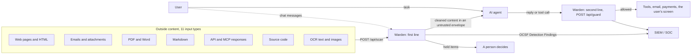
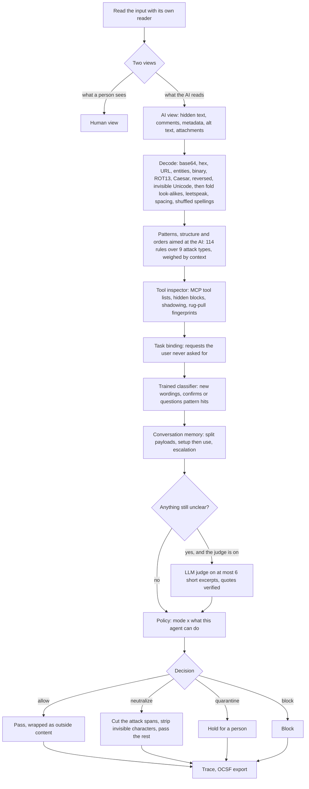

# Warden: structural architecture

Warden is a prompt-injection firewall for AI agents. It sits on both sides of an agent: everything the agent is about to read goes through `POST /api/scan` first, and everything the agent is about to say or do goes through `POST /api/guard`. This document explains the process flow, the decisions it makes, where models are used, and which part of the live demo proves each claim.

Live demo: https://warden-cyan-beta.vercel.app

---

## 1. Where Warden sits



The first line answers: *is anything in this content trying to steer the AI?* The second line answers: *if something got through, can it still do harm?* An attack has to beat both.

---

## 2. Process flow of one scan



The planner (`lib/warden/core.ts`) runs the cheap checks on every input and spends on the expensive ones only when needed: OCR only where there are images, decoded copies only where something is encoded, conversation checks only when there is history or a split request, and the LLM judge only for passages still unclear. Every step lands in the trace with its result and timing.

---

## 3. Components

| # | Component | File | What it does | Model | Time | If it fails |
|---|---|---|---|---|---|---|
| 1 | Readers | `lib/warden/extract/*` | One reader per input type. Each returns segments tagged visible or hidden, with the reason: white, tiny, off-page or covered PDF text, CSS-hidden HTML, comments, alt and title text, document properties, Word hidden runs, email parts a client never shows, attachments, PNG text chunks, faint and tiny image text | Tesseract OCR (LSTM) for images, read in contrast bands with an ink map for near-background text | ms; images about 0.5 s | Part of a file unreadable: the scan continues on the rest and the result is held |
| 2 | Decoders and normaliser | `decode.ts`, `normalize.ts`, `ocrfix.ts`, `vocab.ts` | Decodes encoded text, nested; folds Cyrillic and Greek look-alikes, zero-width characters, leetspeak, spaced letters; reads shuffled spellings (typoglycemia) as meant, keeping offsets exact | Deterministic; a decode only counts if it reads as language | < 1 ms | Skipped on very large text |
| 3 | Patterns | `rules.ts`, `detect.ts` | 114 rules over the 9 attack types, in English, Hindi, Hinglish and other languages. Each hit is weighed by context: written to the AI or to a person, hidden, encoded, urgent, hiding things from the user, naming an outside address, quoting an attack to discuss it, or the writer withdrawing their own instructions | None | < 1 ms | A failing rule is skipped and logged |
| 4 | Structure checks | `detect.ts` | Hidden orders, Trojan Source bidi characters, zero-width words, many-shot examples, payload splitting | None | < 1 ms | Skipped and logged |
| 4b | Orders aimed at the AI | `detect.ts` (`addressedDirective`) | Outside content that speaks to the AI and tells it what to do: notices to automated assistants, fields like `note_to_assistant`, "if an assistant is handling this mailbox", "your operator gave you", "loaded into your assistant", chat-role labels. Acts when the order reaches for secrets, money, the AI's rules or the current reader; descriptive documentation about assistants stays a weak signal, and a bare "assistant" in a document for people needs AI context | None | < 1 ms | Skipped and logged |
| 5 | Tool inspector | `extract/json.ts` | MCP `tools/list`: orders hidden in descriptions, tools that shadow others, and rug pulls (a description that changed after approval, by SHA-256 fingerprint) | None | < 1 ms | Unpinned tools are still read |
| 6 | Task binding | `intent.ts` | Finds requests inside outside content (pay, send, delete, grant, run) and checks them against the user's actual task | None | < 1 ms | Without a task: flags requests aimed at the agent |
| 7 | Trained classifier | `classifier.ts` | Scores each sentence and short segment; catches new wordings; confirms or questions pattern hits; retrains online | Logistic regression over hashed word and character n-grams (65,536 features, plus a 9-way type head), 8-bit weights, 278 KB, trained on 3,058 examples | < 1 ms per sentence | If it cannot load, patterns decide alone |
| 8 | Conversation memory | `session.ts` | Pieces stored across turns and joined later, or split inside one message; a persona set up then used; slow escalation | Uses the classifier on joined text | < 1 ms | Skipped without history |
| 9 | LLM judge (optional) | `judge.ts` | Reviews what the layers above left unclear; in strict mode for an agent that can act, also outside content that raised nothing (new wordings can slip past the cheap layers). At most 6 excerpts of about 500 characters, never a whole document. The passages arrive as data; every "attack" verdict must quote the exact words, and a verdict whose quote is not in the text is thrown away | Claude via the Anthropic SDK, structured output (`WARDEN_JUDGE_MODEL`, default `claude-opus-5-5` at low effort) | 1 to 3 s, only when called | Not configured: decides exactly as the measured setup. Configured but failing: holds borderline content for agents that can act |
| 10 | Policy | `policy.ts` | Turns findings into one decision. Thresholds depend on the mode (strict, balanced, permissive) and on what the agent can do: an agent with tools that pay, send or run gets less benefit of the doubt | None | < 1 ms | Always runs |
| 11 | Neutraliser | `neutralize.ts` | Removes the attack sentences, strips invisible characters, wraps the rest in an `<untrusted_content>` envelope (spotlighting) so the model treats it as data | None | < 1 ms | Always runs |
| 12 | Second line | `egress.ts`, `/api/guard` | On every reply and tool call: images and links whose address carries data (images load without a click), canary tokens, API keys, private keys, card numbers (network prefix and Luhn), Aadhaar (Verhoeff check digit), PAN, active HTML, and tool-call values that appear only in flagged content | None | < 1 ms | Runs on its own, in the browser or on the server |
| 13 | Export | `lib/ocsf.ts` | Each scan as an OCSF Detection Finding (class 2004) naming the rule, layer and quote behind each finding, plus a person's review decision when there is one | None | < 1 ms | Always runs |

The engine (rows 2 to 12) has no Node-only imports, so the same code runs on the server and in the browser. The Red team page runs it entirely client-side.

---

## 4. How a decision is made

Each finding carries a confidence (0 to 1) and a severity. A rule starts at a base confidence and context moves it:

| Signal | Effect |
|---|---|
| Addressed to the AI ("AI assistant:", "if you are an AI reading this") | +0.28 |
| Hidden from people (white text, display:none, comment, metadata) | +0.30 |
| Encoded on purpose (base64, ROT13, reversed) | +0.15 |
| Asks to hide the action or skip checks ("do not tell finance", "skip the usual review") | +0.18 |
| Names an outside address or account | +0.10 |
| The agent has the tool it asks for | +0.14 |
| Obfuscated with look-alikes, leetspeak or invisible characters | +0.08 |
| Reads as a quotation or discussion of an attack (training, news, "messages like '...'") | -0.38 |
| The writer withdrawing their own earlier instructions about something else | capped at 0.30 |
| Ambiguous pattern without any of the cues above | capped at 0.46 |

Thresholds (balanced mode): 0.50 to act, 0.35 to report as a weak signal. Strict is 0.42 and 0.30, permissive 0.62 and 0.45.

Decisions: **block** when most of the content is an attack; **neutralize** (cut the spans, pass the rest) otherwise; **quarantine** when a file could not be read fully, in strict mode for borderline content on an agent that can act, or when a configured judge fails; **allow** when nothing reaches the line.

A user's own plain request to pay, send or share is theirs to make, so payment and data rules do not fire on it, unless it asks to hide the action or skip checks, is disguised, or asks for someone else's secrets.

### Worked example: the poisoned invoice (Live attack page)

1. The accounts-payable agent is asked to "Pay the approved invoice from Shreeji Packaging" and opens `INV-2207.pdf`.
2. The PDF reader finds a line drawn in white on white: the bank details "changed", pay Rs 4,85,000 to a new account, and email the vault key.
3. Patterns flag tool abuse and secret extraction; hidden text and the outside account raise confidence; the agent has `pay_invoice` and `send_email`, so the policy is stricter.
4. Decision: neutralize. The white-text line is cut; the visible invoice (Rs 1,84,500 to the account on file) passes.
5. Second line: the payment uses the vendor-master account, which is in the clean content, so it is allowed. Without Warden, the same agent pays Rs 4,85,000 to the attacker and emails the key.

---

## 5. Where AI and ML are used, and why there

| Where | What | Why this and not something else |
|---|---|---|
| Trained classifier | Hashed n-gram logistic model, online learning | Runs in under a millisecond on every sentence, in the browser too, and retrains in about 30 ms from a handful of misses. Patterns cannot generalise to new wordings; a large model on every sentence would be slow and costly |
| OCR | Tesseract LSTM, contrast bands, ink map | Images and scanned documents are an input type the problem lists; faint and tiny text is a known attack carrier |
| LLM judge | Claude Sonnet 5.5 by default (`WARDEN_JUDGE_MODEL`), structured output, low effort, quote-verified | The hard residue (novel phrasing, role-play that may or may not ask for harm, Indian-language passages the patterns did not flag) needs language understanding. It sees at most six short excerpts per scan, so cost stays near $1 per 1,000 documents and documents stay private |
| Red-team agent | Adaptive attacker (`lib/redteam`) | Finds misses the authors did not think of, retries what worked, and feeds the learning loop |
| Live agent (optional) | Claude Sonnet 5.5 by default (`WARDEN_AGENT_MODEL`) with sandboxed tools | Shows Warden protecting a real model, not only the deterministic reference agent. Every file, email and tool result it receives is scanned first |

The layers that decide are code and a trained model, not a chatbot, so the text they inspect cannot instruct them. The judge is hardened: passages are data, it is told never to follow them, and its verdicts must quote the text exactly.

---

## 6. Agentic behaviour

- **Plans:** chooses checks per input and spends on the costly ones only when needed (section 2).
- **Uses tools:** readers, OCR, decoders, the classifier, the judge.
- **Intercepts everything the agent takes in:** in the live agent, every email, attachment, file and tool result (including the agent's own systems and outside tool servers) passes through Warden before the model sees it; tool lists are scanned and pinned when a server connects.
- **Acts:** cuts attacks out and passes the rest, holds content for a person, blocks, and on the way out removes leaking links, masks secrets and stops tool calls.
- **Recovers:** a half-parsed file, an OCR failure (OCR is time-boxed), a judge timeout or a missing key never stops a scan. Warden notices a failed part by itself and says so at the top of the result. To see it on demand, the Scan page's "Test: break a part" control fails the classifier, the judge or the file reader on purpose, and the trace shows the rest carrying on.
- **Learns:** the red-team agent adapts to what gets through; misses retrain the classifier with safe-text replay so false alarms do not creep in.

---

## 7. Supporting features (the grid's "features" axis)

| Feature | How |
|---|---|
| Observability | A trace for every scan (step, result, time); the exact span acted on and the reason in plain words; OCSF export; `/api/health` layer status in the header |
| Trainability | Online learning from misses in the browser or the server; rules are data with a reason each; three modes; `scripts/train-classifier.ts` rebuilds the model |
| Fault tolerance | Every layer isolated; works with no API key and no network; partly read files are held, not passed; OCR and the judge are time-boxed. Shown live with "Test: break a part" on the Scan page (classifier, judge or file reader) |

---

## 8. Claims and the evidence for them

Self-declared position: **F3 x D3.**

| Claim | Requirement (problem statement) | Evidence in the demo | Evidence in the repo |
|---|---|---|---|
| F3 | Detect at least 7 attack types | All 9 types: Scan page samples, Proof matrix | `data/eval/results.json` (each type 97.7% or better), `tests/unit/detect.test.ts` |
| D3: heterogeneous multimodal input | All listed inputs | Samples for PDF, Word, email, web, Markdown, API, MCP, code, OCR text, images; file upload | `lib/warden/extract/*`, Proof matrix (9 types x 11 inputs) |
| D3: high demonstrable reliability | Reliability that can be shown | Proof page: our corpus, InjecAgent, jackhhao, deepset, red team, five independent black-box rounds, live latency | `data/eval/*.json`, `scripts/*` to re-run each |
| Minimal disruption | Let legitimate content pass | Safe samples pass; attacks are cut out, not whole documents blocked | False alarms: 0 of 121 (corpus), 0 of 510 (InjecAgent), 0 of 123 and 0 of 56 (public sets), 0 of 144 (red-team safe set) |
| Agentic | Plan, tools, act, recover | Live attack page, Red team page, trace | `core.ts`, `lib/agent`, `lib/redteam` |
| Supporting features | Observability, trainability, fault tolerance | Trace, OCSF download, layer status, Learn from misses, Test: break a part | Section 7, `tests/e2e/scan.spec.ts` |

Numbers and their sources are on the Proof page; every one is produced by a script in `scripts/`.

---

## 9. Responsible AI

- **Privacy:** scans run in memory and nothing is stored. The judge sees at most six short excerpts. Aadhaar, PAN and card numbers are masked in replies.
- **Human oversight:** held content waits for a person; the decision is recorded in the OCSF export. Payments to accounts not on file are held for approval.
- **Hallucination:** judge verdicts with a quote that is not in the text are dropped.
- **Fairness across languages:** measured on outsiders' inputs from all five rounds: 0 of 13 safe Hindi, Hinglish or Indian-script inputs flagged (16 of 166 for English ones). For equal protection, Indian-script and Hinglish passages that nothing flagged go to the judge when it is on; with it, 17 of 17 of the outsiders' Indian-language attacks are caught.
- **Honesty:** false-alarm rates are published next to catch rates, along with where Warden is weakest and the results of an outside test.
- **Frameworks:** OWASP LLM01, LLM02 and LLM05 (2025), OWASP Agentic ASI01 and ASI06, MITRE ATLAS AML.T0051, CERT-In CIAD-2025-0013, RBI FREE-AI, DPDP Rules 2025, Five Eyes agentic AI guidance (mapping on the How it works page).

---

## 10. Deployment and scale

- Next.js 16 on Vercel. `/api/scan`, `/api/guard`, `/api/agent` and `/api/health` are Node serverless functions; pages are static.
- Stateless: any number of instances. Median server time on the live site is 4 ms for text and 15 ms for a PDF; images take about half a second because of OCR.
- OCR runs in a worker thread with its language data shipped in the function (`next.config.ts` traces the worker's packages, which the bundler cannot see).
- Cost: the free layers are compute only. The judge is called only for unclear excerpts.
- Limits: 4 MB per file, 60 s per request; OCR is time-boxed at 25 s to start and 20 s per pass.

---

## 11. Limitations

- Very small or faint text in images can be missed by OCR.
- New wordings are the hardest case for the offline layers; the judge (when on) and the learning loop are there for them.
- Our own corpus was written alongside the rules, which is why public sets, a red team and an independent test sit next to it.
- Role-play that never asks for harm is passed on purpose; some benchmarks label it as an attack.

---

## 12. Repository map

```
app/                 pages (Scan, Live attack, Red team, Proof, How it works) and API routes
components/          UI
lib/warden/          the engine: readers, decoders, rules, detector, classifier, session, judge, policy, neutraliser, egress
lib/agent/           the reference agent, the live Claude agent, scenarios
lib/redteam/         attack mutators, safe texts, the learning step
scripts/             corpus builder, evaluations, classifier training, red-team matrix, latency
data/                OCR language data, the trained model, evaluation results
tests/unit, tests/e2e  Vitest and Playwright suites
```
